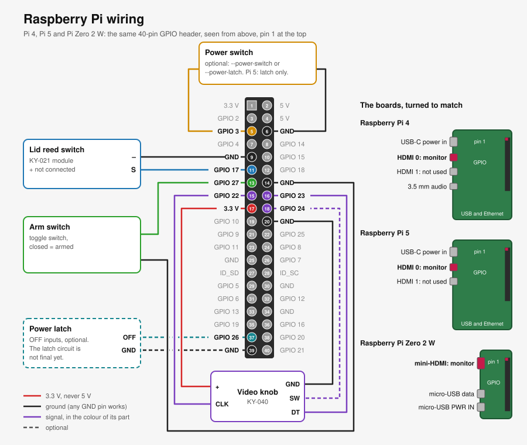
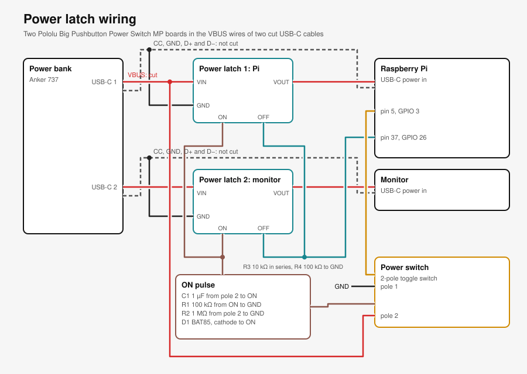
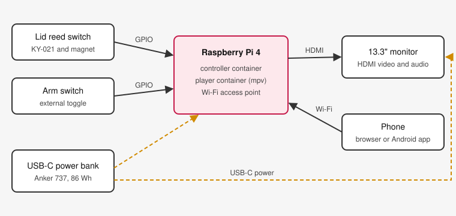

# Wiring

This guide tells you how to connect the switches and the knob to the Raspberry Pi. The controller container reads these parts through the GPIO pins. It then plays, pauses or selects the video. The power bank, the monitor and the HDMI cable are also in this guide.

All supported boards have the same 40-pin GPIO header, so the GPIO wiring is the same on each board. The boards are different in the power input, the HDMI connector and the power switch support. Each board has its own section below.



Fig 1. The GPIO connections on the left are the same for all supported boards. The sketches on the right show each board turned so that the GPIO header is on the right, with pin 1 at the top. The red connector is the monitor port.

## Supported Boards

| Board                                           | Power input                   | Monitor connector  | Power switch without the latch |
| ----------------------------------------------- | ----------------------------- | ------------------ | ------------------------------ |
| [Raspberry Pi 4](#raspberry-pi-4)               | USB-C, 5 V 3 A                | micro-HDMI, HDMI 0 | yes                            |
| [Raspberry Pi 5](#raspberry-pi-5)               | USB-C, 5 V 5 A recommended    | micro-HDMI, HDMI 0 | no                             |
| [Raspberry Pi Zero 2 W](#raspberry-pi-zero-2-w) | micro-USB `PWR IN`, 5 V 2.5 A | mini-HDMI          | yes                            |

## Safety Rules

- Disconnect the power before you connect or disconnect a wire.
- Connect the `+` pin of a module to 3.3 V only. **Never connect 5 V to a GPIO pin or to a module that connects to a GPIO pin.** The GPIO pins operate at 3.3 V, and 5 V can damage the Pi.
- Find pin 1 before you connect a wire. Pin 1 has a square pad. It is at the end of the header that is farthest from the USB ports.
- Do not connect a GPIO pin directly to 3.3 V or to another GPIO pin.

## GPIO Connections

The pin numbers are the physical pin numbers on the 40-pin header. The GPIO numbers are the BCM numbers that the software uses. You can use any `GND` pin for a ground connection. The table gives the ground pins that the diagram uses.

| Part            | Part pin     | Pi pin | Pi signal | Required | `setup.sh` option                     |
| --------------- | ------------ | ------ | --------- | -------- | ------------------------------------- |
| Lid reed switch | `S`          | 11     | GPIO 17   | yes      | none                                  |
| Lid reed switch | `-`          | 9      | GND       | yes      | none                                  |
| Lid reed switch | `+`          | none   | none      | no       | none                                  |
| Arm switch      | contact 1    | 13     | GPIO 27   | yes      | none                                  |
| Arm switch      | contact 2    | 14     | GND       | yes      | none                                  |
| Power switch    | contact 1    | 5      | GPIO 3    | no       | `--power-switch` or `--power-latch`   |
| Power switch    | contact 2    | 6      | GND       | no       | `--power-switch` or `--power-latch`   |
| Power latch     | `OFF` inputs | 37     | GPIO 26   | no       | `--power-latch`                       |
| Power latch     | `GND`        | 39     | GND       | no       | `--power-latch`                       |
| Video knob      | `CLK`        | 15     | GPIO 22   | no       | `--knob`                              |
| Video knob      | `DT`         | 16     | GPIO 23   | no       | `--knob`                              |
| Video knob      | `SW`         | 18     | GPIO 24   | no       | none. The button has no function yet. |
| Video knob      | `+`          | 17     | 3.3 V     | no       | `--knob`                              |
| Video knob      | `GND`        | 20     | GND       | no       | `--knob`                              |

The controller turns on the internal pull-up resistor of each input pin. Thus a switch only connects its GPIO pin to ground. You do not need an external resistor.

## Lid Reed Switch

The KY-021 module has a reed switch between `S` and `-`. A magnet near the switch closes it. Put the module in the case body and the magnet in the lid, so that the magnet is near the module when the lid is closed.

Leave the `+` pin unconnected. The module has a resistor from `+` to `S`, and the internal pull-up of the Pi does the same work. If you connect `+`, connect it to 3.3 V on pin 1 or pin 17. Never connect it to 5 V.

With the default wiring, the lid is closed when GPIO 17 is low. Some sensors are open when the magnet is near. For such a sensor, run `setup.sh --lid-closed-when-high`.

## Arm Switch

The arm switch is a toggle switch on the outside of the case. When the switch is closed, the briefcase is armed. To invert the switch, set `BRIEFCASE_ARMED_WHEN_LOW=false` in `.env`. Refer to the [configuration reference](../software/configuration.md).

## Power Switch

The power switch is optional. It connects GPIO 3 to ground when it is on. When a person turns it off for 2 s, the Pi shuts down cleanly. `setup.sh` turns off I2C, because I2C also uses GPIO 3.

- Without the power latch (`--power-switch`), the switch halts the Pi, and the switch wakes the halted Pi again. The halted Pi still draws some power. A Pi 5 does not wake from halt on GPIO 3, so this mode is not available on a Pi 5.
- With the power latch (`--power-latch`), GPIO 26 also signals the latch at the end of the shutdown, and the latch disconnects the power. This mode operates on all supported boards.

The [power latch](#power-latch) section below shows the full latch circuit.

## Power Latch

The power latch disconnects the Pi and the monitor from the power bank when the power switch is off. The off-state draw is then less than 0.01 µA for each latch. Without the latch, a halted Pi and the monitor still draw power.



Fig 2. Two latches cut only the VBUS wire of the Pi cable and of the monitor cable. Pole 1 of the power switch tells the Pi the switch position. Pole 2 makes a short pulse that turns both latches on. GPIO 26 turns both latches off at the end of the shutdown.

### Latch parts

| Part                                                | Quantity | Notes                                                                                                                               |
| --------------------------------------------------- | -------- | ----------------------------------------------------------------------------------------------------------------------------------- |
| Pololu Big Pushbutton Power Switch MP (Pololu 2812) | 2        | one latch for the Pi line and one for the monitor line. 4.5 V to 40 V, approximately 8 A, less than 0.01 µA when off.               |
| USB-C to USB-C cable, 5 A                           | 2        | you cut each cable in two and connect the latch to the VBUS wire. Use a cable with a USB 2.0 data line, because it has fewer wires. |
| 2-pole toggle switch, on-on (DPDT)                  | 1        | the power switch. It replaces the 1-pole power switch. Pole 2 uses only one of its two contacts.                                    |
| C1, ceramic or film capacitor, 1 µF, 16 V or more   | 1        | the `ON` pulse.                                                                                                                     |
| R1 and R4, resistor 100 kΩ                          | 2        | R1 discharges the `ON` line. R4 holds the `OFF` line low while the Pi has no power.                                                 |
| R2, resistor 1 MΩ                                   | 1        | discharges C1 when the switch is off, so that the next "on" makes a new pulse.                                                      |
| R3, resistor 10 kΩ                                  | 1        | limits the current between GPIO 26 and the `OFF` inputs.                                                                            |
| D1, Schottky diode BAT85 (or 1N5819)                | 1        | stops a negative voltage on the `ON` inputs when C1 discharges.                                                                     |
| heat-shrink tube, stranded wire 0.5 mm² for VBUS    | some     | the VBUS wires carry up to 3 A.                                                                                                     |

Do not use two USB-C receptacle breakout boards for each line. A USB-C cable has one CC wire, and that wire connects to `CC1` or `CC2` at the receptacle, as the plug is turned. With two receptacles, the CC connection breaks for half of the plug positions. A cut cable does not have this problem.

### How the latch operates

1. The power switch goes on. Pole 2 connects 5 V from the Pi line to C1. C1 sends a pulse of approximately 0.15 s to both `ON` inputs, and both latches turn on.
2. The Pi starts, and the monitor gets its power. Pole 1 holds GPIO 3 low, so the controller knows that the switch is on.
3. The power switch goes off. Pole 1 releases GPIO 3. After 2 s, the controller starts a clean shutdown.
4. At the end of the shutdown, the `gpio-poweroff` overlay sets GPIO 26 high. Both latches see a high level on `OFF` and turn off. The Pi loses its power, so GPIO 26 goes low again.
5. R2 discharges C1, so the next "on" makes a new pulse.

The power bank keeps its two outputs on, because the CC wires stay connected. The Pi and the monitor stay "connected" for the power bank. Pole 2 takes its 5 V from the Pi line before the latch. Do not take it from the monitor line, because the monitor can ask the power bank for 9 V or more.

If you turn the switch on again during the shutdown, the Pi still turns off at the end of the shutdown. Then turn the switch off and on again.

### Cable preparation

Do these steps for each of the two cables:

1. Cut the cable in the middle. Remove 5 cm of the outer insulation on each side.
2. Find the VBUS wire. It is usually red. Measure it with a multimeter from the plug to make sure.
3. Solder all other wires again, colour to colour: GND, CC, D+, D− and the shield. Insulate each joint with heat-shrink tube.
4. Solder the VBUS wire from the power bank side to `VIN` of the latch. Solder the VBUS wire from the device side to `VOUT`.
5. Connect `GND` of the latch to the GND wire of the cable.

### The control wires

| From                  | Through                       | To                             |
| --------------------- | ----------------------------- | ------------------------------ |
| GPIO 3 (pin 5)        | pole 1, "on" contact          | GND (pin 6)                    |
| `VIN` of latch 1      | pole 2, "on" contact, then C1 | `ON` of latch 1 and latch 2    |
| `ON` of both latches  | R1                            | GND                            |
| pole 2, C1 side       | R2                            | GND                            |
| GND                   | D1, anode to GND              | `ON` of both latches (cathode) |
| GPIO 26 (pin 37)      | R3                            | `OFF` of latch 1 and latch 2   |
| `OFF` of both latches | R4                            | GND                            |

Do not connect `CTRL`. Pololu recommends pulses on `ON` and `OFF`, and a high level on `CTRL` at the same time as on `OFF` is not allowed.

### Checks before the first use

Do these checks before you close the briefcase. Record the results in the [player notes](../software/player.md).

1. **GPIO 26 at the shutdown.** Do this check before you connect the latch. Run `setup.sh --power-latch`, then run `sudo poweroff`. Measure GPIO 26 (pin 37) to GND. It must go to 3.3 V after the shutdown. On a Raspberry Pi 5 this check is important, because the Pi 5 turns off through its own power chip.
2. **The power bank output.** Turn the switch off, and wait 10 minutes. Measure `VIN` of latch 1. If it is 0 V, the power bank has turned its output off. Then the "on" pulse has no power, and you must press the power bank button before you turn the switch on.
3. **The monitor voltage.** Measure `VIN` of latch 2 while the switch is off. If it is more than 5 V, the monitor gets this voltage directly at the next "on". Make sure that the monitor accepts it.
4. **The power cycles.** Turn the switch off and on 20 times. Each time, the Pi must shut down cleanly before the latches turn off, and the briefcase must become ready again.

## Video Knob

The KY-040 module is a rotary encoder. It selects the next or the previous video while the briefcase is disarmed. Connect its `+` pin to 3.3 V on pin 17. The module has pull-up resistors to `+`, so 5 V on `+` puts 5 V on the GPIO pins.

If one click moves two videos, set `BRIEFCASE_KNOB_STEPS_PER_DETENT=2` in `.env`. If the knob turns the wrong way, set `BRIEFCASE_KNOB_INVERT=true`, or swap the `CLK` and `DT` wires.

## Power and Monitor

The power bank has two USB-C outputs. Connect one output to the Pi and the other output to the monitor. Connect the Pi to the monitor with an HDMI cable. The board sections give the correct cable and port for each board. The monitor plays the sound through HDMI.



## Raspberry Pi 4

The Raspberry Pi 4 is the primary test board of the briefcase.

| Connector                                      | Connect to                                      |
| ---------------------------------------------- | ----------------------------------------------- |
| USB-C power input                              | a USB-C output of the power bank. Use 5 V 3 A.  |
| micro-HDMI port HDMI 0, next to the USB-C port | the monitor, with a micro-HDMI to HDMI cable.   |
| micro-HDMI port HDMI 1                         | nothing.                                        |
| 3.5 mm audio jack                              | the optional amplifier, if you add one.         |
| Ethernet                                       | your router, to update the software (optional). |

The Pi 4 wakes from halt when GPIO 3 goes low. Thus you can use the power switch before you have the power latch. Use `--power-switch` for the switch alone, and `--power-latch` when the latch is fitted.

`setup.sh --power-switch` checks the bootloader setting `WAKE_ON_GPIO`. If it is `0`, the script shows a warning. Then run `sudo rpi-eeprom-config --edit` and set `WAKE_ON_GPIO=1`.

## Raspberry Pi 5

The Raspberry Pi 5 is a supported board.

| Connector                                      | Connect to                                    |
| ---------------------------------------------- | --------------------------------------------- |
| USB-C power input                              | a USB-C output of the power bank.             |
| micro-HDMI port HDMI 0, next to the USB-C port | the monitor, with a micro-HDMI to HDMI cable. |
| micro-HDMI port HDMI 1                         | nothing.                                      |

The Pi 5 has no 3.5 mm audio jack. The sound goes through HDMI to the monitor.

HDMI 1 also works. `setup.sh` finds the port that has the monitor and sends the picture and the sound to that port. Connect the monitor and turn it on before you run `setup.sh`. If you move the cable to the other port later, run `setup.sh` again.

The Pi 5 asks for a 5 V 5 A supply. A normal USB-C power bank gives 5 V 3 A. With 3 A, the Pi 5 can show a warning, and it limits the current of its USB ports. The briefcase does not use the USB ports, so it operates with 3 A.

**A Pi 5 does not wake from halt when GPIO 3 goes low.** Only its power button wakes it. Thus the power switch alone could shut the Pi down, but it could not start it again. `setup.sh` refuses `--power-switch` on a Pi 5. Use the power switch only with the power latch, with `--power-latch`. The latch applies the power, and a Pi 5 starts when it gets power. Until the latch is fitted, do not connect the power switch.

## Raspberry Pi Zero 2 W

The Raspberry Pi Zero 2 W is a supported board for lower power.

| Connector               | Connect to                                                                        |
| ----------------------- | --------------------------------------------------------------------------------- |
| micro-USB port `PWR IN` | a USB-C output of the power bank, with a USB-C to micro-USB cable. Use 5 V 2.5 A. |
| micro-USB port `USB`    | nothing. This is the data port. It does not power the board well.                 |
| mini-HDMI port          | the monitor, with a mini-HDMI to HDMI cable.                                      |

The Zero 2 W has no 3.5 mm audio jack. The sound goes through HDMI to the monitor.

Many Zero 2 W boards have no header pins. Solder a 2×20 male header to the board, or buy the Zero 2 WH, which has the header fitted. The header has the same pin layout as the Pi 4 and the Pi 5.

The Zero 2 W wakes from halt when GPIO 3 goes low. Thus you can use the power switch before you have the power latch. Use `--power-switch` for the switch alone, and `--power-latch` when the latch is fitted.

The Zero 2 W has 512 MB of memory and decodes H.264 only. Use H.264 videos at 1080p30 or less. The [transcode script](../../tools/transcode.sh) makes such a file.

## Set Up Command

Run `setup.sh` with the options for the parts that you connected. For example, on a Pi 4 or a Zero 2 W with the knob and the power switch:

```bash
sudo ~/rickroll_briefcase/scripts/setup.sh --knob --power-switch
```

On a Pi 5, use `--power-latch` instead of `--power-switch`, and only when the latch is fitted.

## Diagram Source

[wiring_diagrams.py](../../tools/wiring_diagrams.py) makes the wiring diagram, and [latch_diagram.py](../../tools/latch_diagram.py) makes the power latch diagram. After you change one of them, run it from the repository root:

```bash
python3 tools/wiring_diagrams.py
python3 tools/latch_diagram.py
```

## See also

- [Configuration](../software/configuration.md)
- [Architecture](../software/architecture.md)
- [Video and diagram tools](../../tools/README.md)
